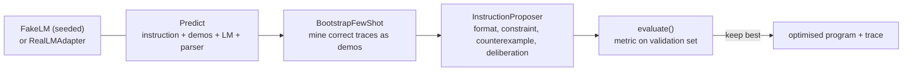

# Jagadish-dspy-prompt-optimizer

[](https://github.com/jagadishmazure-jpg/Jagadish-dspy-prompt-optimizer/actions/workflows/ci.yml)
[](https://github.com/jagadishmazure-jpg/Jagadish-dspy-prompt-optimizer/actions/workflows/codeql.yml)


**Prompt optimisation as a program, in the spirit of DSPy: parametrise the instruction and few-shot demos, define a metric, and let an optimiser search. Independent study implementation; deterministic and offline.**

> Personal learning and portfolio project. Everything runs offline on synthetic,
> fictional data with no API keys. Nothing is deployed. Numbers in this README
> come from real runs and are re-checked by CI (`scripts/render_docs.py --check`).

## Recruiter summary

- Shows how to replace hand-tuned prompts with a measured propose, evaluate, select loop: bootstrap few-shot demos, then search instruction variants.
- Real run: sentiment validation score goes 0.625, 0.875, 1.0 across baseline, bootstrap and instruction search; ticket extraction goes 0.667 to 1.0 with one bootstrapped demo.
- Honest about the test double: scores come from a deterministic FakeLM on 8 and 6 validation cases.

## Purpose

Hand-tuned prompts drift when the model, the task or the edge cases change.
The idea I studied in DSPy (Stanford NLP) is to optimise the program instead:
make the instruction and demonstrations parameters, score them on data, and keep
what wins. This is my own small implementation for learning; it is not
affiliated with or a port of the DSPy project.

## Architecture



## How it works

1. `Predict` holds everything an optimiser may change: instruction, demos, LM and parser.
2. **Baseline:** score the starting program on the validation set.
3. **Bootstrap:** run the program on training data and keep correct traces as few-shot demos (up to `max_demos`).
4. **Instruction search:** apply deterministic mutations (format rule, constraint, counterexample hint, deliberation hint) and score each.
5. Each stage keeps the best program so far, so the trace never goes down.

`FakeLM` is a seeded test double with three behaviours: it only formats cleanly
when told how, gets mixed-signal inputs wrong without demos, and needs an
explicit hint for sarcasm. See [docs/how-it-works.md](docs/how-it-works.md).

## Real code and output

```python
"""Optimise a sentiment classifier and a ticket extractor against the deterministic FakeLM."""
from dspyopt import FakeLM, Predict, build_oracle, optimize, parse_json, parse_label
from dspyopt.dataset import extract_task, sentiment_task


def run(name, task, instruction, parse_fn):
    oracle = build_oracle(task["train"] + task["val"])
    program = Predict(instruction=instruction, lm=FakeLM(oracle=oracle, seed=0), parse_fn=parse_fn)
    optimized, trace = optimize(program, task["train"], task["val"])
    print(f"--- {name}: {len(task['train'])} train / {len(task['val'])} validation examples")
    for stage in trace:
        print(f"  {stage['stage']:<12} val score {stage['score']}")
    print("  demos kept:", len(optimized.demos))
    print("  final instruction:", optimized.instruction)


run("sentiment", sentiment_task(),
    "Classify the sentiment. Respond with exactly one of: positive, negative.", parse_label)
run("ticket extraction", extract_task(),
    "Extract the ticket priority and category as JSON.", parse_json)
```

Output of `python examples/demo.py` (real run, re-checked in CI):

<!-- run: python examples/demo.py -->
```text
--- sentiment: 12 train / 8 validation examples
  baseline     val score 0.625
  bootstrap    val score 0.875
  instruction  val score 1.0
  demos kept: 1
  final instruction: Classify the sentiment. Respond with exactly one of: positive, negative. Watch out for mixed signals and sarcasm; the overall judgment determines the answer.
--- ticket extraction: 8 train / 6 validation examples
  baseline     val score 0.6667
  bootstrap    val score 1.0
  instruction  val score 1.0
  demos kept: 1
  final instruction: Extract the ticket priority and category as JSON.
```
<!-- /run -->

## How to run

```bash
git clone https://github.com/jagadishmazure-jpg/Jagadish-dspy-prompt-optimizer.git
cd Jagadish-dspy-prompt-optimizer
python -m pip install pytest      # no runtime dependencies
python -m pytest -q          # offline, no keys
python examples/demo.py
python scripts/render_docs.py --check   # documented output still matches
```

Test suite size (real collection, re-checked in CI):

<!-- run: python scripts/count_tests.py -->
```text
31 tests collected
```
<!-- /run -->

## Guardrails

- Train and validation splits are disjoint; demos come only from training data.
- Stage selection never accepts a lower score than the previous stage.
- Same seed and data give the same result.
- The live LM adapter is a stub that raises until it is wired up, so nothing calls a model by accident.

## Limitations

- All scores are against FakeLM, whose behaviours were written to respond to demos and hints; the 1.0 shows the optimiser finds the fix, not that it would on a real model.
- Validation sets are tiny (8 sentiment and 6 ticket cases).
- Greedy demo selection and four fixed instruction mutations; no LLM-proposed instructions.
- `llm_judge_agreement` is a normalised string comparison standing in for a real judge model.

## Built vs planned

| Capability | Status | Where |
|---|---|---|
| Predict program and parsers | Built | `dspyopt/program.py` |
| Metrics and evaluate() | Built | `dspyopt/metrics.py` |
| Bootstrap few-shot and instruction search | Built | `dspyopt/teleprompt.py` |
| Seeded FakeLM test double | Built | `dspyopt/lm.py` |
| Live LM adapter (Azure OpenAI) | Planned | stub in `dspyopt/lm.py` |
| Larger real datasets and LLM-proposed instructions | Planned | not started |

## Implementation guide

The step-by-step path from this offline build to an Azure deployment is in
[docs/implementation-guide.md](docs/implementation-guide.md). None of it has been
run; it is a plan.

## Related repositories

| Repo | How it relates |
|---|---|
| [Jagadish-llm-evals-observability](https://github.com/jagadishmazure-jpg/Jagadish-llm-evals-observability) | Evaluation harness the optimiser's metric could plug into |
| [Jagadish-lora-finetuning](https://github.com/jagadishmazure-jpg/Jagadish-lora-finetuning) | The other way to adapt a model: change weights, not prompts |
| [Jagadish-langchain-langgraph-langsmith](https://github.com/jagadishmazure-jpg/Jagadish-langchain-langgraph-langsmith) | Prompt management in a framework |

## Documentation

- [How it works](docs/how-it-works.md)
- [Concepts](knowledge/01-concepts.md)
- [Diagrams](knowledge/02-architecture.md)
- [Implementation guide (Azure)](docs/implementation-guide.md)
- [Interview points](docs/interview-points.md)
- [Security policy](SECURITY.md)

## Project layout

```
dspyopt/
  lm.py          LM protocol, FakeLM, RealLMAdapter stub
  program.py     Predict, parsers
  metrics.py     exact_match, contains_all, evaluate
  teleprompt.py  BootstrapFewShot, InstructionProposer, optimize
  dataset.py     synthetic sentiment and ticket tasks
examples/demo.py the run shown above
tests/           offline pytest suite
```

## License

MIT, see [LICENSE](LICENSE). All data is synthetic; every organisation and person is fictional.
